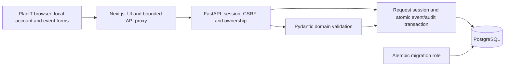

# PlanIT architecture

Status: Phase 7 quality and security hardening audits the completed Phase 1–6 implementation: AI intake/plans, deterministic budget/timeline, vendor evidence/personalization and revision-safe adaptive replanning. See [schema](SCHEMA.md), [API](API.md), [security](SECURITY.md), [testing](TESTING.md), and [quality report](PHASE_7_REPORT.md).

## Approved decisions and boundaries

- Continue without installing local Docker. Native Node.js/Python/PostgreSQL is the verified development path; Compose remains optional and its runtime verification is deferred.
- The user selected local username/password accounts with secure database-backed sessions instead of the proposed unconfigured OIDC provider. No identity bypass, seeded shared account or external provider is needed. Production identity/recovery decisions remain later work.
- Individual event ownership is the authorization boundary. Organization is a constrained foundation model, not shared tenancy. Client-supplied ownership is rejected. Phase 5 exposes owner-scoped vendor comparison and quote evidence APIs; operational guest workflows remain deferred.
- Retain the modular monolith: Next.js presentation/proxy, FastAPI validation/authorization/transactions, PostgreSQL durability. A bounded Gemini generateContent adapter provides intake and initial drafts; deterministic services own money and schedule invariants. Live vendor integrations, bookings, workers, Redis and vector stores remain absent.



## Current implementation

Next.js 16.4.3, React 19.3.1, TypeScript 5.9.3 on Node 24.14.1/npm 11.11.0. Python 3.14.4, FastAPI 0.162.0, Pydantic 2.14.1, SQLAlchemy 2.1.6, psycopg 3.3.6, Alembic 1.20.1 and Uvicorn 0.54.0, with PostgreSQL 18.4. Exact resolved packages are in package-lock.json and hashed Python runtime/development locks. tzdata is explicit for consistent IANA support on Windows and Linux. These are tested pins, not a claim of latest production-approved patches. ESLint 9 remains pinned for Next.js plugin peers despite its upstream maintenance warning.

The root layout owns the shared shell and account context. Public overview/gallery/status routes remain accessible. /register and /sign-in manage real accounts; /events, /events/new, /events/[id], and /events/[id]/edit use authenticated client requests. Data is never placed in shared server-render caches. Account changes clear protected views, including other tabs. Browser session tokens stay in HttpOnly cookies; only the CSRF token/profile live in React state.

The Next.js proxy allowlists methods/paths, bounds bodies and time, filters headers/cookies, ignores forwarded identity/host headers, and never accepts arbitrary upstream URLs. It compares browser Origin to HTTP Host; FastAPI independently checks the exact configured origin and session-bound CSRF token. Health has its separate schema-validating proxy. OpenAPI generates TypeScript contracts through a checked-in reproducible script.

Synchronous routes use request-scoped SQLAlchemy sessions; no blocking DB work is placed in an async event loop. Event creation/edit/archive commit with their audit records before returning success. Edit/archive lock the owner-scoped row and compare an ETag revision. Failure rolls back; competing updates cannot silently overwrite one another. No network provider call is part of these transactions.

Migration 0002_domain introduces the requested relational schema, indexes, constraints and owner/audit guards while preserving the foundation revision. Readiness checks SELECT 1 and the exact current revision; liveness has no database dependency. General statements are bounded to five seconds, readiness statements to one second. Native PostgreSQL remains under ignored .local/postgres on port 55432, independent of the existing Windows service. Runtime and migration credentials remain separate.

Money uses integer minor units, strict safe-integer bounds and BigInt/string frontend conversions. Dates accept local wall time plus IANA timezone and explicit DST occurrence when needed, persist UTC instants, and reconstruct local views. Confirmed/completed events require complete core intake; incomplete drafts are allowed. Null needs are unknown; empty strings explicitly mean none.

## Implemented directory structure

```text
apps/web/
  src/app/              routes, layout, fallbacks, bounded API proxies
  src/components/ui/    buttons, fields, textarea, cards, dialogs, feedback
  src/components/       shell, account forms/context, event form/workspace
  src/lib/              typed API helper, generated contracts, exact money
  src/styles/           theme, shared components, workspace, event layouts
  tests/                desktop/mobile browser and money verification
  scripts/              standalone build preparation and local launcher
services/api/
  app/api/              health/accounts/events routers, request DB dependency
  app/core/             settings, auth, safe errors, request logging/body limit
  app/domain/           validated intake and related model contracts
  app/db/               SQLAlchemy models and bounded connections
  migrations/           frozen Alembic revisions and metadata environment
  tests/                unit, API, real PostgreSQL, concurrency/restart checks
scripts/                native DB lifecycle, verification, contract generation
infra/postgres/         separate-role Compose bootstrap
.github/workflows/      application and deferred container CI jobs
docs/                   schema, API, architecture, security and phase evidence
```

The app/ai adapter and app/api/planning workflow implement only approved intake and initial generation. No speculative integration services are scaffolded. Existing SVG artwork, system fonts, responsive shell and accessible native UI primitives remain in use.

## Phase 3 planning boundary

The user explicitly approved AI intake and initial planning as Phase 3, superseding the original Budget Guardian sequencing. A request first commits an owner-scoped run and releases admission locks. The synchronous, deadline-bounded provider call runs outside the event transaction. Strict output validation and integer allocation precede a short transaction that rechecks the event revision, updates confirmed intake, inserts a new draft and audit, and completes the run. Failed or stale runs preserve existing plans.

Responses uses a required, nullable extraction schema and a separate proposal schema. Models propose category weights; Python computes amounts and calendar dates. Plan JSON is stored on EventPlanVersion, without materializing BudgetItem/Task rows or introducing approval/replanning behavior. UI revisions and idempotency keys protect edits and uncertain retries. See API.md for request semantics and SECURITY.md for disclosure, limits and residual risks.

## Retained Phase 0 proposals for later phases

The following model and planning sections describe the original long-term design, not current functionality. Phase 2 now establishes the requested relational foundations; SCHEMA.md is authoritative for the implemented schema. Local username/password accounts replace the proposed OIDC identity for this phase by explicit user choice. Requirements, expenses, immutable approval snapshots, decisions, dependency graphs, approval workflows and integrations below remain proposals. Generation runs and editable draft documents are now implemented as described in SCHEMA.md.

All entities use server-generated UUIDs and UTC creation/update timestamps. Persist IANA event timezone separately. Mutable aggregates have an integer revision. Event-owned children carry `event_id`; composite foreign keys prevent references to records in another event. IDs supplied by clients do not establish ownership.

| Entity | Initial fields and relationships |
| --- | --- |
| User | `id`, unique `(oidc_issuer, oidc_subject)`, optional display name; email is not an identity key |
| Session | Hashed opaque session token, `user_id`, expiry, revocation; OIDC transient state/nonce/PKCE material has short expiry |
| Event | `owner_id`, title, type (`wedding`, `birthday`, `community`), local event date/time, timezone, duration minutes, location, guest count, currency, budget ceiling, preferences, dietary/accessibility needs, constraints, intake completeness, lifecycle status, active plan ID, revision |
| Requirement / Assumption | Event or plan scope, field/category, value, source, confirmation status; distinguish unknown, supplied, and explicitly accepted assumptions |
| PlanVersion | `event_id`, sequence, parent plan ID, base event revision, scenario (`economical`, `balanced`, `premium`), schema/template/prompt versions, state, requirement snapshot, validation findings, approval metadata |
| BudgetItem | Plan-version scope, stable item key, category, description, integer quantity, unit amount, explicit tax/fee amounts, calculated total, provenance; reserve is stored separately |
| Expense | Event scope, stable budget-item key if assigned, amount, currency, incurred date, source/notes, revision; actual costs are separate from immutable plan snapshots |
| Task / TaskSpec | Stable event task identity and current status/actual completion; versioned specs hold title, owner label, due date, duration, offset anchor and constraint flags. Owner labels do not grant access. |
| TaskDependency | Plan-version scope, predecessor/successor stable task keys, dependency type; acyclic and same-event only |
| VendorRecord | Event scope, service category, contact fields, provenance, verification timestamp/source when applicable; no default rating or availability |
| VendorRequirement / Quote | Plan requirements; vendor quote currency, itemization, stated availability interval, expiry, source, user-recorded booking status, and evidence reference |
| CreativeConcept | Plan scope, theme/menu/activity/invitation content, constraints considered, assumptions and provenance |
| Decision | Event/plan scope, question, options, pending/resolved state, deciding user and timestamp |
| ChangeProposal | Base plan ID and event revision, proposed input changes, candidate plan ID, deterministic impact diff, validation results, pending/approved/rejected/stale status |
| GenerationRun | Event, request/idempotency key and input hash, base revision, model/prompt/schema versions, status, start/end, latency, token usage, safe error code |
| AuditEntry | Actor, event, action, target IDs, request ID, timestamp, minimal before/after metadata; append-only to normal application operations |

The Phase 2 request explicitly brought the base plan, budget, task, vendor, quote and guest models forward. Their advanced workflows still require approval in the phases below. Add further migrations with the phase introducing the corresponding behavior. Approved snapshots are the source of historical plan truth. Relational draft projections support editing and queries; they must agree with the snapshot at approval.

## Deterministic invariants

### Intake and dates

Incomplete draft events are allowed. Generation and approval require type, event date/time, IANA timezone, positive duration, location, positive integer guest count, supported currency, nonnegative budget ceiling, and explicit responses about dietary/accessibility needs. Preference details may be omitted only with visible assumptions. Revalidate on every mutation.

Store event instants in UTC and local date/time/timezone for interpretation. Validate ambiguous or nonexistent local times and ask for a specific offset when needed. Date-only deadlines stay local dates; event-day slots use instants. An end must follow its start. A new future-event plan cannot silently schedule tasks in the past. Mark impossible lead times as conflicts requiring a decision. Completed tasks retain actual completion times on rescheduling.

Dependency graphs must be acyclic, have no self or missing references, and stay within an event/plan. Enforce predecessor finish before dependent start. Detect overlapping assigned owner/resource slots where time intervals exist; do not claim resource conflict detection from date-only deadlines.

### Money

Use integer minor units for stored amounts and API money fields; use Decimal for percentage calculations and round half-up at explicit boundaries. Maintain an allowlisted currency exponent registry; JPY has zero fractional digits while INR/USD/EUR/GBP use two. Disallow mixing currencies and values outside safe JSON integer bounds. Reject negative costs and fractional minor units. Any future fractional quantities use Decimal strings, never binary floats.

- `line_total = quantity * unit_amount + tax_amount + fee_amount` (all monetary terms in minor units).
- `planned_total = sum(line_total) + contingency_reserve`; reserve counts once and has an explained, editable basis.
- `actual_total = sum(recorded_expenses)`; no recorded spending is shown as “not supplied,” not confirmed zero expenditure.
- `planned_balance = ceiling - planned_total`; `cash_remaining = ceiling - actual_total`, labeled as based on recorded spending and incomplete where appropriate.
- `forecast_total = recorded_actuals + estimated_unpaid_costs + remaining_reserve`; matched actuals replace the paid portion of an estimate, never add the same commitment twice.
- `projected_overrun = max(0, forecast_total - ceiling)`; do not clamp negative balances out of the UI.

Unknown remaining costs make a forecast incomplete. A partial payment alone cannot establish an unpaid balance; require a confirmed total or a labeled estimate. Over-budget proposals remain visible but cannot be approved as within budget. Resolve them through explicit scope or ceiling changes. Scenarios share assumptions and expose trade-offs; estimates are never quotes.

### Approval and concurrency

Plan content transitions `draft -> proposed -> approved` or `proposed -> rejected`. Failed validation leaves an editable draft with findings. Accepted content becomes immutable. The event's active-plan pointer determines the current approved version; older approved versions remain accessible.

Approval checks ownership, expected aggregate revisions, base plan, task/expense revisions used in the proposal, and all invariants inside a database transaction. Atomically write the new approved snapshot, update event requirements and active-plan pointer, preserve completed task state and actual spending, and append an audit entry. A stale proposal returns a conflict and must be regenerated or reviewed again. Rejecting a proposal never changes the approved plan. Do not hold locks while calling the model.

Before an approved plan exists, event inputs may be edited directly. After approval, changes affecting budget, date, guests, duration, constraints, or location must use a proposal and explicit approval. Routine task status and expense entries remain separately audited operational changes; they invalidate affected pending proposals.

## AI contract and failure behavior

Use the Responses API for schema-shaped proposals. Its Structured Outputs format is `text.format` with a supported JSON Schema; unsupported schemas and refusal/incomplete responses require explicit handling. Schema conformity does not establish arithmetic or factual correctness. [Official Structured Outputs guide](https://developers.openai.com/api/docs/guides/structured-outputs).

Function calling asks the application to execute a capability; the application must validate and authorize every call. Use strict argument schemas and an explicit capability allowlist. Initial capabilities only read authorized event data or run pure budget/timeline calculations. Saving a draft, approval, external sharing, and financial actions are not model permissions. [Official function calling guide](https://developers.openai.com/api/docs/guides/function-calling).

Proposed initial limits: 60-second total generation deadline, at most 3 model requests including any retry, at most 5 tool invocations, one retry for a transient failure within the same deadline, and 4,000 output tokens per request. These are application policy targets to benchmark in Phase 5. Disable nested SDK retries so the application can enforce the shared budget. Record latency, actual usage when returned, and unknown usage after timeouts; do not invent a cost total. Apply per-user quotas and a configurable daily token budget before enabling paid calls.

The model ID remains unset until documented capability checks and an account-backed smoke test pass. Recheck compatibility whenever SDK/model settings change. Do not assume optional parameters work across models. Version prompts and schemas alongside regression fixtures. No Agents SDK is justified at baseline.

AI disabled, refusal, timeout, rate limit, invalid schema, impossible plan, or provider outage must leave existing data intact and produce a retryable or actionable state. Users can still edit manual plans. Seeded offline examples display “demonstration data”; they must never masquerade as successful live generation. Only relevant, user-disclosed event requirements are sent to the provider; no guest contact list or vendor secret is needed.
