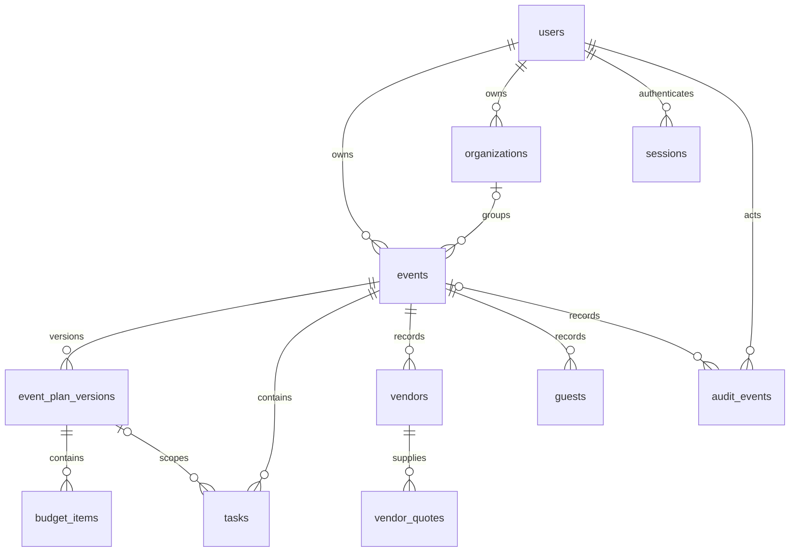

# Database schema through Phase 6

PostgreSQL 18, SQLAlchemy models in `services/api/app/db/models.py`, validated contracts in `app/domain/schemas.py`, frozen migrations through `0006_replanning`. Run `alembic upgrade head`; a clean database receives all revisions. Migrations never run during request handling.

| Table | Stored content and boundary |
| --- | --- |
| users | UUID, unique normalized username, display name, salted scrypt hash, timestamps |
| organizations | Owner user, name, timestamps; reserved grouping, no membership/sharing/API |
| sessions | SHA-256 token hash PK, user FK, creation/expiry/revocation |
| auth_limits | Hashed account/peer key, window start, atomic attempt count |
| events | Immutable owner, optional same-owner organization, intake, event currency, UTC dates/timezone, status, revision, archive timestamp |
| event_plan_versions | Event, sequence, base event revision, same-event parent, title/status, approval metadata; revision, intake/document JSONB, saved_at, schema/prompt version |
| generation_runs | Owner/event, idempotency key/hash, operation/state/lease, expected revision, model, bounded calls, latency/tokens/error code, extraction or same-event plan reference |
| replan_proposals | Owner/event, frozen base plan/event revision, requested change, deterministic impact, alternative document, pending/accepted/rejected/stale state and accepted plan lineage |
| budget_items | Same-event plan, category/description, event currency, integer quantity/unit/tax/fee, generated total |
| tasks | Event, optional same-event plan, title/description, status, due/completion instants |
| vendors | Event-local vendor name/category/location, inclusions, evidence, cancellation/deposit fields and explicit provenance/source label |
| vendor_quotes | Same-event vendor, event currency, integer amount, issue/expiry date, status, inclusions, evidence, cancellation/deposit and provenance |
| guests | Event, name/contact, RSVP, party size, dietary/accessibility needs |
| audit_events | Actor/event, action, revision, request UUID, changed field names, timestamp; append-only |
| alembic_version | Current revision 0003_ai |

## Integrity and lifecycle

Record entities use generated UUIDs and timezone-aware creation/update timestamps. Sessions, limits and append-only audit records have purpose-specific timestamps. SQLAlchemy maintains ordinary updated_at values; event mutations set them explicitly. Event instants use timestamptz with a separate IANA timezone. Local wall times/folds are validated on input and reconstructed on output, avoiding conflicting duplicate date columns.

Foreign keys restrict destructive removal of domain history. Sessions alone cascade on user deletion; there is no deletion endpoint. Composite relationships enforce organization/owner, event/owner, event/currency, plan/event and vendor/event consistency. Tasks cannot reference another event's plan; quotes cannot reference another event's vendor. Plan approvers and audit actors must own the event.

Database checks enforce event types/status, title/text bounds, dates, guest/money bounds, confirmed/completed intake, archive timestamp/status consistency, positive revisions and bounded JSON arrays. A trigger validates timezone names and forbids event owner changes. Pydantic adds richer validation, including individual preference strings and nonexistent/ambiguous local times. Administrator SQL is not a substitute for public API validation.

Plans have unique (event_id, sequence), positive base revision, no self-parent, and consistent approval metadata. Editable drafts and revision-safe replanning are implemented; approved versions are preserved, while guest RSVP and full calendar workflows remain outside this build. Task states are todo/in_progress/done/cancelled; only done has completed_at. Guest RSVP is pending/attending/declined/tentative, party size 1-100. Quote status is received/accepted/rejected/expired; expiry cannot precede issue date. Vendor provenance cannot claim external verification.

## Exact money

BIGINT amounts are integer minor units bounded by 9,007,199,254,740,991 for exact JSON/JavaScript interchange. Supported currencies are INR/USD/EUR/GBP (two digits) and JPY (zero). Python integers and frontend BigInt/string conversion avoid floating-point financial arithmetic.

budget_items.total_minor is generated from `quantity::numeric * unit_amount_minor + tax_minor + fee_minor` and checked against the same safe range. Quantity is 1-1,000,000. Tax and fee are explicit amounts. Event/currency foreign keys prevent mixed-currency children and block changing currency while incompatible children exist. No percentage, reserve, forecast or aggregate budget workflow exists yet.

## Transactions, indexes and permissions

Create/edit/archive and audit insertion commit atomically. Errors roll back with the request session. Update/archive lock the owner-scoped event and check ETag revision. Audit triggers reject UPDATE/DELETE; runtime grants prohibit them as well. Audit stores field names, not sensitive before/after values; this is not cryptographic tamper evidence against administrators.

Events index (owner_id, created_at, id) and (owner_id, status, created_at, id) for keyset scans, plus organization. Other access indexes cover organization owner, session user/expiry, auth window cleanup, event/plan budgets, event/due tasks, event vendors, event/vendor quotes, event/RSVP guests and event/time plus actor audits. Unique indexes back usernames and composite relationship targets.

The native/Compose bootstrap separates eventora_admin, eventora_migrator and eventora_app. Existing default SELECT grants cover migrated tables. Revision 0002 grants runtime INSERT on users/audit, INSERT/UPDATE on events, and INSERT/UPDATE/DELETE on sessions/auth_limits. It grants no DDL, domain DELETE or audit UPDATE. Revision 0003 adds SELECT/INSERT/UPDATE on generation_runs and event_plan_versions, plus UPDATE(updated_at) on users solely to permit per-user SELECT FOR UPDATE admission locks. Other passive child models still have no runtime write APIs/grants. Deployments using other role names must provision equivalent grants; disposable CI uses a migration-capable test role.

There is no PostgreSQL row-level-security policy. FastAPI owner predicates enforce request authorization; the trusted backend role can read multiple owners and must never be exposed to browsers/end users. Organization membership and shared access are not implemented.

`alembic check` detects model drift. Integration tests require a database ending in _test, rebuild migrations and truncate fixtures. Downgrade 0002 destroys its tables and is exercised only on disposable data; deployment rollback requires a separate backup/restore plan.

## Phase 3 additions

EventPlanVersion stores a validated intake snapshot and PlanDocument as paired nullable JSONB columns. Legacy rows with both null remain intact and are excluded from the structured draft list. Checks require positive document revision/schema_version and paired nullability. schema_version=1 and prompt_version=eventora-intake-plan-v1 identify the current contracts. saved_at distinguishes an explicitly reviewed save from the initial generated draft. No operational BudgetItem or Task records are silently created.

GenerationRun has an immutable association by foreign key with its owner/event and any resulting same-event plan. UNIQUE(event_id, request_key) supports idempotency. A SHA-256 hash compares the canonical operation/body/revision; the raw natural-language description is not retained. Validated extraction and draft text are private stored content. State/operation and 0-2 call bounds are checked; owner/time and event/time indexes support admission quotas and recent history. A user row lock serializes admission; provider I/O holds no event/user lock. Lease expiry marks interrupted requests rather than silently retrying paid work.

Model weights are allocated with integer largest remainders, so the initial allocation exactly equals the budget ceiling. These are budget envelopes, not independent market price estimates or affordability evidence. Edits store exact amounts and recompute totals/remaining outside the model. Preparation lead days become calendar dates in the event's timezone; passed dates are flagged. Approval snapshots, expense tracking, reserve rules and dependency-aware scheduling remain out of scope.

Migration 0003 preserves existing data and adds plan.generated/plan.saved to the audit action constraint. A downgrade refuses when those audit actions exist instead of deleting immutable history. The successful migration-cycle test uses disposable data only. Reverting a populated deployment requires a separately reviewed recovery plan.
